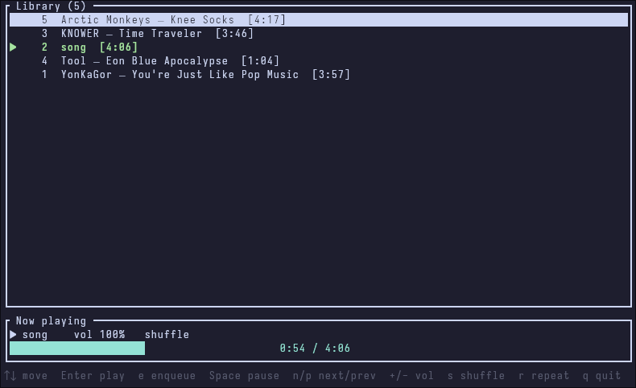

# WAP

## Overview
WAP is my personal vision on what an actually usable local music player should look like. I have a decent sized music library, but i can't find a player that would have all the features i want. That's why i'm making my own WAP is an acronym for Working Audio Player, because well, its an audio player that actually works.

The main goal is for it to be lightweight, modular, scalable, have a good amount of useful features and of course play music.

## Features checklist

- [x] music playback

- [x] folder indexing

- [x] basic database stuff

> [!NOTE]
> <details> <summary><b>DB support</b></summary>
> 
>
> Right now it's a bit of a dead weight, because the db is stored in ram.
>
> This can be easily be changed, but i don't see any point in doing so until proper support for larger audio libraries is implemented.
> </details>

- [ ] background indexing and parsing

- [ ] good support for large audio libraries

- [ ] biased shuffle queue mode

- [ ] actual backend/frontend separation

- [ ] better frontend
---

## Prerequisites & Installation
- **Rust:** Version `>=1.88.0`
- **System:** `libasound2-dev` (Linux only)

### Building from source
```bash
git clone https://github.com/FishyNavi/wap.git   # clone into the repo
cd wap                                           # cd into the project folder
cargo build --release                            # build from source
```

---
## Usage & Examples
Download and navigate to a folder with binary.
```bash
wap <dir>      # open wap and search for music in <dir>
               # by default the indexing dir is ./

#### example ######
             
wap ./music    # open wap and index ./music dir

```
<details><summary>An image of the TUI</summary>



</details>
There's a small hint on control keys on the bottom. 

Some clarification if it's unclear what does what:

- `s` - shuffles the player's queue. It doesn't have any visual feedback
- `r` - toggles between shuffle and repeat queue modes.
- `e` - adds selected position to the **end** of temporary queue. 

Others are pretty self explenatory
